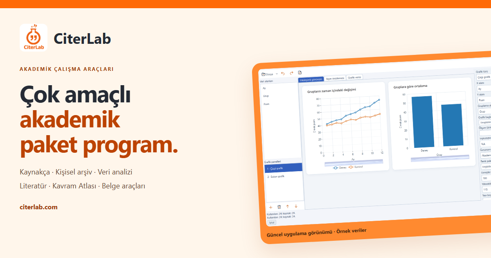
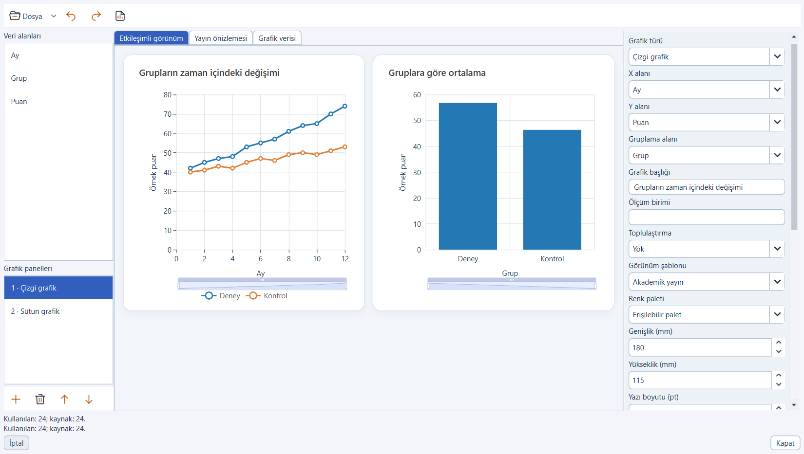
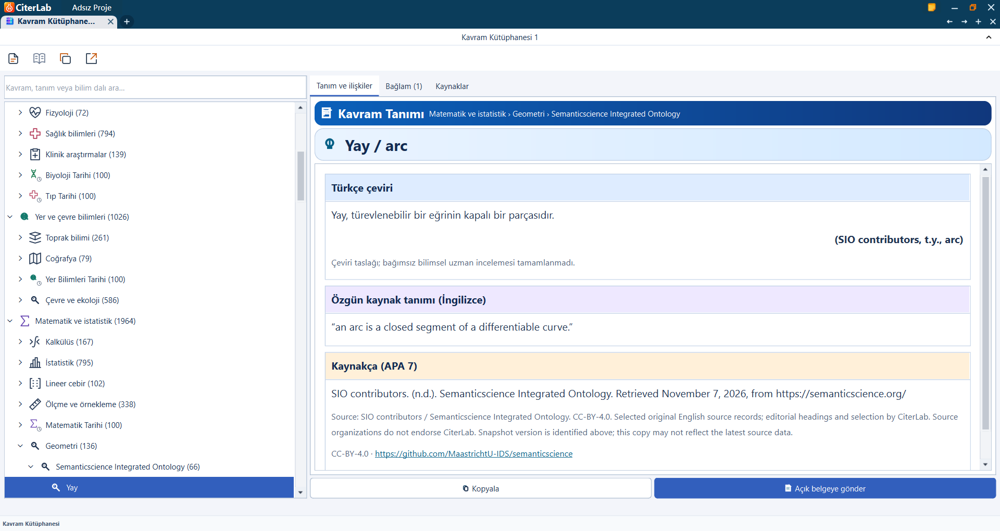
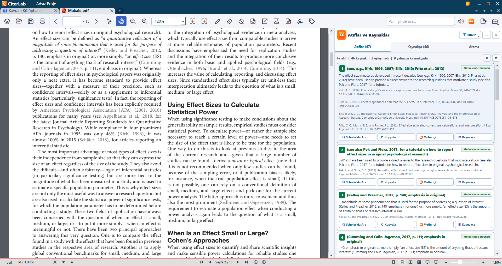

# CiterLab
[Türkçe](README.md) · [English](README.en.md) · [Deutsch](README.de.md) · [العربية](README.ar.md)

**حزمة برامج أكاديمية متعددة الأغراض**

CiterLab تطبيق لسطح مكتب Windows يجمع أدوات العمل بالمصادر وأرشيف الاقتباسات الشخصي والتحليل الإحصائي والمستندات.

هذا المستودع عرض رسمي لمنتج CiterLab. لا يحتوي على الشفرة المصدرية للتطبيق أو حزمة تثبيت قابلة للتشغيل.

يجري إعداد الإصدار. راجع الموقع الرسمي لمعرفة توفر التنزيل والشراء حاليًا.

## ماذا يمكنك أن تفعل؟

- **اكتشف مشكلات المراجع بوضوح أكبر** — قارن الاستشهادات داخل النص بقائمة المراجع. راجع حالات عدم التطابق والمشكلات المحتملة في الكتابة أو التنسيق، ثم تتبّع السجل باستخدام أدوات التحقق المتصلة بالإنترنت.
- **أرشيفك الشخصي، مرتبط بمصادره** — اجمع الاقتباسات التي تختارها وبيانات مصادرها من المستندات المدعومة في أرشيفك الشخصي. ابحث محليًا، وانسخ المحتوى أو أرسله إلى مستندك، واحتفظ بنسخة احتياطية لنقل الأرشيف إلى حاسوب آخر.
- **استكشف الأدبيات وتعرّف إلى سبل الوصول إليها** — ابحث دون إنترنت في مكتبة CiterLab التي نزّلتها. وعند الاتصال، وسّع بحثك عبر المصادر المتاحة على الشبكة، وأرشف الملخصات المتاحة، وافتح ملفات PDF المتاحة للوصول المفتوح.
- **حلّل بياناتك في سياق سؤال البحث** — صل إلى أدوات التحليل الكمي بالصوت أو بالكتابة أو بالاختيار المباشر، واستفد من التقارير بصيغة APA مع مراجعة المنهج والافتراضات. استخدم ARIMA/SARIMA للسلاسل الزمنية، والانحدار التجميعي بالمربعات الصغرى والتأثيرات الثابتة والعشوائية للبيانات اللوحية، ومقارنة هاوسمان التقليدية.
- **ادرس النصوص والعلاقات بين المنشورات** — استخدم أدوات التحليل النوعي والتحليل الببليومتري في مساحة العمل نفسها. قيّم النتائج في ضوء نطاقها؛ فالنتائج الببليومترية تعتمد على مجموعة البيانات المختارة ومزوّديها والمعلومات المتاحة وقت الوصول.
- **عُد إلى المعرفة مع مصادرها** — استكشف نحو 10 آلاف مفهوم، ومكتبة المناهج والأدلة المرجعية السريعة. اعمل دون إنترنت على المحتوى الذي نزّلته، وراجع المصدر واللغة والترخيص وحالة مراجعة الترجمة معًا.
- **مساعدة الذكاء الاصطناعي وفق اختياراتك** — لخّص النصوص المدعومة واستمع إليها بأدوات القراءة الصوتية. استخدم النماذج المحلية بعد تنزيلها على جهاز مناسب، أو فعّل الذكاء الاصطناعي السحابي الاختياري بعد الاطلاع على معلومات نقل البيانات ومنح موافقة مستقلة. راجع الملخص دائمًا بالرجوع إلى النص الأصلي.
- **أنجز مهام المستندات ضمن مسار بحثك** — قسّم ملفات PDF وادمجها، واستخدم أدوات التوقيع، واعمل على مستندات Office المدعومة وحوّل بين الصيغ المتاحة. تحقّق بشكل مستقل من نوع التوقيع وحالة التحقق في المستند الناتج.
- **شاهد العلاقات الرياضية بوضوح** — استكشف الدوال والعلاقات الرياضية بصورة تفاعلية باستخدام الحاسبة الرسومية. غيّر القيم، ولاحظ الرسم البياني، وواصل حساباتك إلى جانب الأدوات الأخرى في مساحة عملك.

## شاشات التطبيق الحالية

تُظهر الصور واجهة التطبيق باللغة التركية.

### استوديو الرسوم البيانية

رسوم أُنتجت في التطبيق الحقيقي من بيانات تجريبية اصطناعية؛ وليست نتائج بحثية.

### أطلس المفاهيم

تبقى بيانات المصادر وحالة مراجعة الترجمات ظاهرة في الواجهة.

### فحص المراجع

صفحة داخلية من مقالة حقيقية مفتوحة الوصول. صفحة العنوان مستبعدة ومرشح الاقتباسات المطابقة محدد. النتائج مطابقات خوارزمية ولا تعني التحقق من المنشورات الأصلية.

## النطاق والاستخدام

يمكن استخدام الأدوات المحلية ومكوّنات المكتبة والنماذج المنزّلة دون اتصال. يتطلب التفعيل الأول وتنزيل المكوّنات والاستعلام عن المصادر عبر الإنترنت اتصالًا. يعتمد دعم الملفات والتحليلات على العملية. يجب مراجعة المطابقات والافتراضات الإحصائية ومخرجات الذكاء الاصطناعي.

## روابط رسمية

- [الموقع](https://citerlab.com)
- الدعم: [info@citerlab.com](mailto:info@citerlab.com)

## الحقوق ومصادر الصور

يتضمن NOTICE.md بيان الحقوق للمواد الأصلية لـ CiterLab. تحتفظ المقالات والمصادر الخارجية بتراخيصها؛ راجع ATTRIBUTIONS.txt. هذا العرض ليس شهادة ملكية للشفرة المصدرية أو ختمًا زمنيًا موثوقًا.

تاريخ سجل العرض: 2026-11-08.
