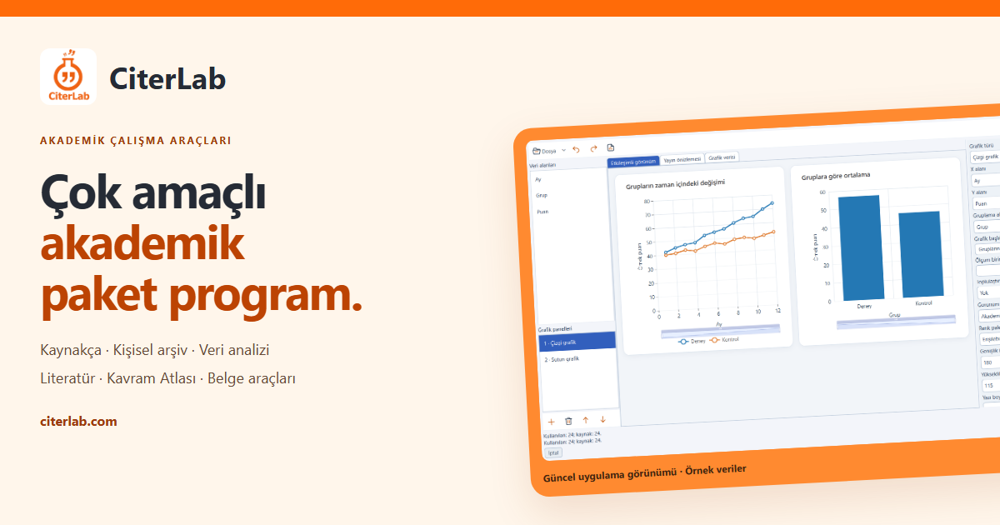
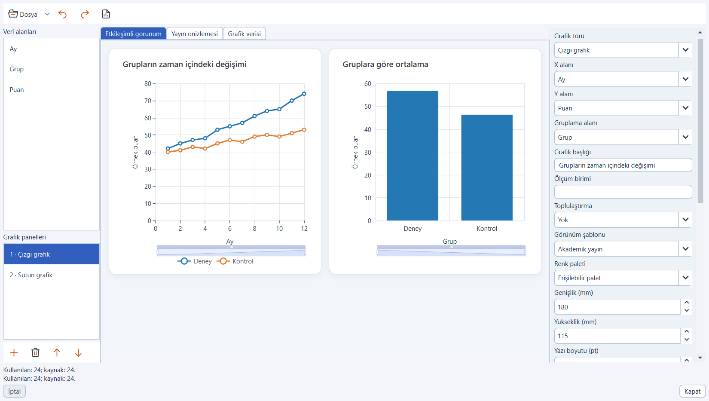
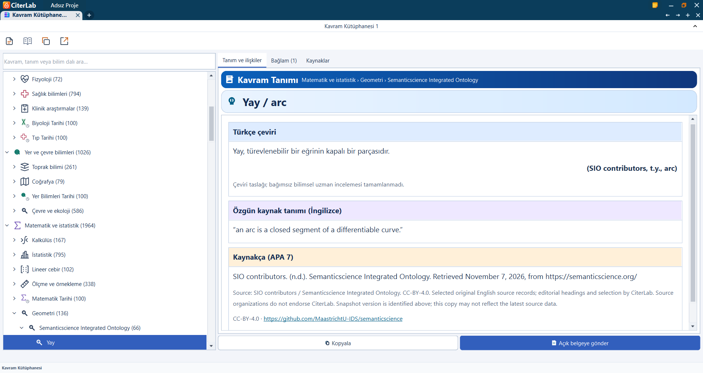
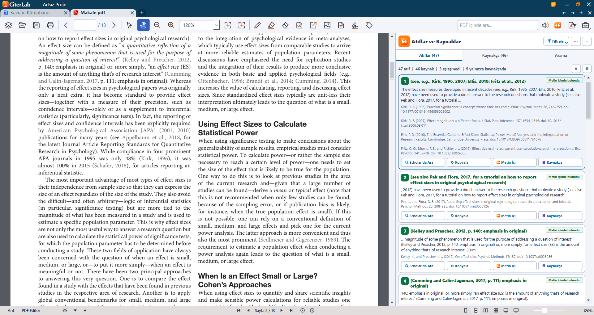

# CiterLab
[Türkçe](README.md) · [English](README.en.md) · [Deutsch](README.de.md) · [العربية](README.ar.md)

**Vielseitiges akademisches Softwarepaket**

CiterLab ist eine Windows-Desktopanwendung für Quellenarbeit, ein persönliches Zitatarchiv, statistische Analysen und Dokumentwerkzeuge.

Dieses Repository ist die offizielle Produktvorstellung von CiterLab. Es enthält weder den Quellcode der Anwendung noch ein ausführbares Installationspaket.

Die Veröffentlichung wird vorbereitet. Aktuelle Downloads und Verkaufsinformationen finden Sie auf der offiziellen Website.

## Was können Sie tun?

- **Unstimmigkeiten im Literaturverzeichnis erkennen** — Vergleichen Sie Kurzbelege im Text mit Ihrem Literaturverzeichnis. Prüfen Sie fehlende Zuordnungen sowie mögliche Schreib- und Formatierungsfehler und verfolgen Sie den Eintrag mit Werkzeugen zur Online-Prüfung zurück.
- **Ihr eigenes Archiv mit Verbindung zu den Quellen** — Sammeln Sie ausgewählte Zitate und Quellenangaben aus unterstützten Dokumenten in Ihrem persönlichen Archiv. Suchen Sie lokal, kopieren Sie Inhalte oder übertragen Sie diese in Ihr Dokument. Sichern Sie Ihr Archiv für den Umzug auf einen anderen Computer.
- **Literatur entdecken und Zugangswege nachvollziehen** — Durchsuchen Sie Ihre heruntergeladene CiterLab-Bibliothek auch ohne Internet. Erweitern Sie Ihre Recherche bei bestehender Verbindung um Online-Quellen, archivieren Sie verfügbare Abstracts und öffnen Sie frei zugängliche PDFs.
- **Daten im Zusammenhang mit Ihrer Forschungsfrage untersuchen** — Rufen Sie quantitative Werkzeuge per Sprache, Texteingabe oder direkter Auswahl auf und nutzen Sie Berichte im APA-Format mit bewusster Prüfung von Methode und Annahmen. Arbeiten Sie mit ARIMA/SARIMA, gepoolter OLS für Paneldaten, festen und zufälligen Effekten sowie dem klassischen Hausman-Vergleich.
- **Texte und Beziehungen zwischen Publikationen untersuchen** — Nutzen Sie qualitative Analyse und bibliometrische Werkzeuge im selben Arbeitsbereich. Bewerten Sie die Ergebnisse im Kontext: Bibliometrische Auswertungen hängen vom gewählten Datensatz, den Anbietern und den zum Abrufzeitpunkt verfügbaren Informationen ab.
- **Wissen mit nachvollziehbaren Quellen nutzen** — Entdecken Sie rund 10.000 Begriffe, die Methodenbibliothek und kompakte Nachschlagehilfen. Arbeiten Sie mit heruntergeladenen Inhalten offline und berücksichtigen Sie Quellen, Sprache, Lizenz und Prüfstatus der Übersetzung.
- **KI-Unterstützung nach Ihren Entscheidungen** — Fassen Sie unterstützte Texte zusammen und lassen Sie diese mit Vorlesewerkzeugen wiedergeben. Verwenden Sie heruntergeladene lokale Modelle auf geeigneter Hardware oder aktivieren Sie optionale Cloud-KI nach Prüfung der Datenübertragung und gesonderter Einwilligung. Vergleichen Sie Zusammenfassungen stets mit dem Ausgangstext.
- **Dokumentaufgaben im Forschungsablauf erledigen** — Teilen und verbinden Sie PDFs, nutzen Sie Signaturwerkzeuge, arbeiten Sie mit unterstützten Office-Dokumenten und konvertieren Sie verfügbare Formate. Prüfen Sie die Art der Signatur und den Verifizierungsstatus des fertigen Dokuments gesondert.
- **Mathematische Zusammenhänge sichtbar machen** — Untersuchen Sie Funktionen und mathematische Beziehungen dynamisch mit dem Grafikrechner. Ändern Sie Werte, beobachten Sie den Graphen und führen Sie Ihre Berechnungen neben den anderen Werkzeugen im Arbeitsbereich fort.

## Aktuelle Programmoberfläche

Die Bildschirmfotos zeigen die türkische Oberfläche.

### Diagrammstudio

In der echten Anwendung aus synthetischen Beispieldaten erzeugte Diagramme; keine Forschungsergebnisse.

### Begriffsatlas

Quellenangaben und Hinweise zum Prüfstatus der Übersetzungen bleiben sichtbar.

### Literaturprüfung

Innenseite eines echten Open-Access-Artikels. Titelseite ausgeblendet, Filter für zugeordnete Zitate gewählt. Die Ergebnisse sind algorithmische Zuordnungen und keine Prüfung der Originalveröffentlichungen.

## Umfang und Nutzung

Lokale Werkzeuge und heruntergeladene Bibliotheks- und Modellkomponenten funktionieren offline. Erstaktivierung, Downloads und Online-Quellenabfragen benötigen eine Verbindung. Unterstützte Dateien und Analysen hängen vom Vorgang ab. Zuordnungen, statistische Annahmen und KI-Ausgaben müssen überprüft werden.

## Offizielle Links

- [Website](https://citerlab.com)
- Support: [info@citerlab.com](mailto:info@citerlab.com)

## Rechte und Bildquellen

NOTICE.md enthält den Rechtehinweis zu eigenem CiterLab-Material. Für fremde Artikel und Quellen gelten deren Lizenzen; siehe ATTRIBUTIONS.txt. Diese Vorstellung ist kein Nachweis des Quellcodeeigentums oder vertrauenswürdiger Zeitstempel.

Datum der Produktvorstellung: 2026-11-08.
