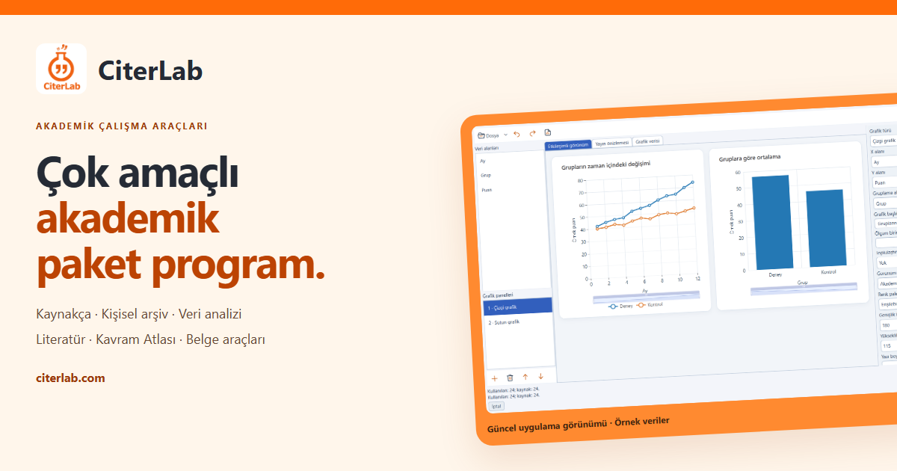
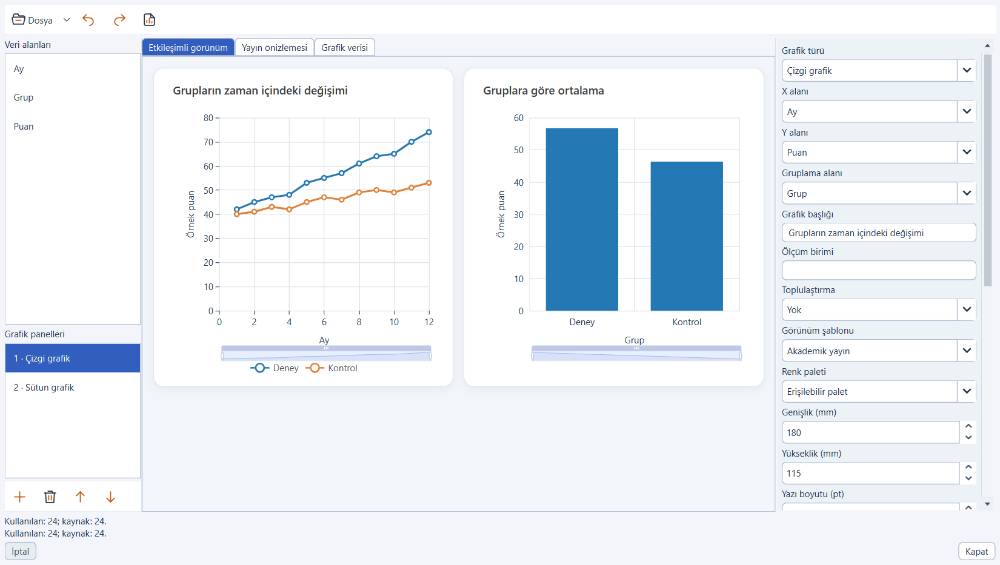
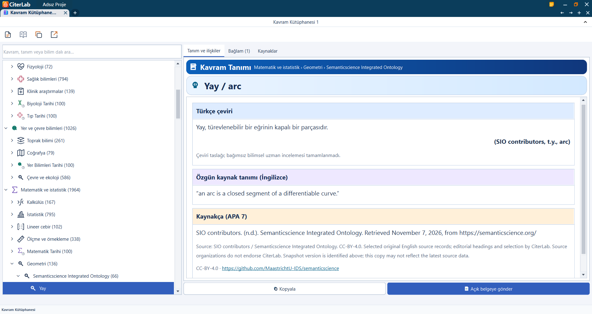
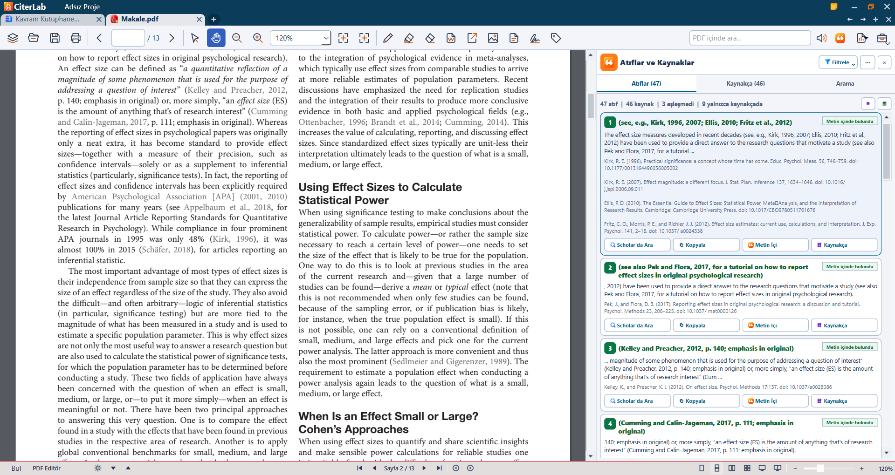

# CiterLab
[Türkçe](README.md) · [English](README.en.md) · [Deutsch](README.de.md) · [العربية](README.ar.md)

**Multipurpose Academic Software Suite**

CiterLab is a Windows desktop application combining source management, a personal quotation archive, statistical analysis and document tools.

This repository is the official CiterLab product showcase. It contains no application source code or runnable installer.

Release preparation is in progress. Check the official website for current download and sales availability.

## What can you do?

- **Make reference issues easier to see** — Compare in-text citations with your reference list. Review missing matches and possible spelling or formatting issues, then use online verification tools to trace the record.
- **An archive of your own, connected to its sources** — Bring selected quotations and source details from supported documents into your personal archive. Search locally, copy or send material to your document, and back up your archive for another computer.
- **Discover literature with a clear path to access** — Search your downloaded CiterLab library offline. When connected, extend your research through online sources, archive available abstracts and reach openly accessible PDFs.
- **Explore your data in the context of your question** — Reach quantitative tools by voice, text or direct selection, and use APA-style reports while checking methods and assumptions. Work with ARIMA/SARIMA time series models, pooled OLS, fixed and random effects for panel data, and the classical Hausman comparison.
- **Investigate texts and publication relationships** — Use qualitative analysis and bibliometric tools in the same workspace. Review the findings with their scope in mind: bibliometric results depend on the selected dataset, providers and information available at the time of access.
- **Return to knowledge with a source** — Explore approximately 10,000 concepts, the methods library and quick reference guides. Work offline with downloaded content, and review its sources, language, license and translation review status together.
- **Keep AI assistance under your control** — Summarize supported texts and listen with text-to-speech tools. Use downloaded local models on suitable hardware, or enable optional cloud AI after reviewing the transfer information and giving separate consent. Always check summaries against the source text.
- **Keep document tasks within your research workflow** — Split and merge PDFs, use signature tools, work with supported Office documents and convert between available formats. Check the signature type and the verification status of the resulting document separately.
- **Make mathematical relationships visible** — Explore functions and mathematical relationships dynamically with the graphing calculator. Change values, observe the graph and continue your calculations alongside the other tools in your workspace.

## Current application screens

Screenshots show the Turkish interface.

### Chart studio

Charts produced in the actual application from synthetic sample data; they are not research findings.

### Concept Atlas

Source attribution and translation-review notices remain visible in the interface.

### Reference checking

The body of a real open-access article, with its title page excluded and matching-citation filter selected. The results are algorithmic matches, not verification of the underlying publications.

## Scope and use

Local tools and downloaded library/model components can work offline. Initial activation, component downloads and online source queries require a connection. File and analysis support depends on the operation. Users must review matches, statistical assumptions and AI output.

## Official links

- [Website](https://citerlab.com)
- Support: [info@citerlab.com](mailto:info@citerlab.com)

## Rights and image attribution

NOTICE.md identifies rights in original CiterLab material. Third-party articles and sources retain their own licenses; see ATTRIBUTIONS.txt. This showcase is not a certificate of source-code ownership or a trusted timestamp.

Showcase snapshot date: 2026-11-08.
