# CiterLab
[Türkçe](README.md) · [English](README.en.md) · [Deutsch](README.de.md) · [العربية](README.ar.md)

**Çok Amaçlı Akademik Paket Program**

CiterLab; kaynaklarla çalışma, kişisel alıntı arşivi, istatistiksel analiz ve belge araçlarını bir araya getiren Windows masaüstü uygulamasıdır.

Bu depo CiterLab’ın resmî ürün tanıtımıdır. Uygulamanın kaynak kodunu veya çalışan kurulum paketini içermez.

Yayın hazırlığı sürüyor. Güncel indirme ve satış durumu için resmî web sitesini kontrol edin.

## Dört gerçek çalışma örneği

**28 sekme türü ve 1 VCF dönüştürme diyaloğu: toplam 29 araç.**

Her araç, uygulamadaki simgesi ve gerçek çalışma ekranıyla gösterilir. Projelerim de bu envantere dahildir; VCF aracı ayrı bir diyalogdur.

Ekranlar Türkçe arayüzden, gerçek uygulama teması altında Windows %125 ölçekte alınmıştır. Örnek veriler ve çalışılmış örnekler araştırma bulgusu değildir. Sonuçları veri, yöntem ve kaynak kapsamıyla birlikte değerlendirin.

<table>
<tr>
<td><a href="#module-excel_analiz">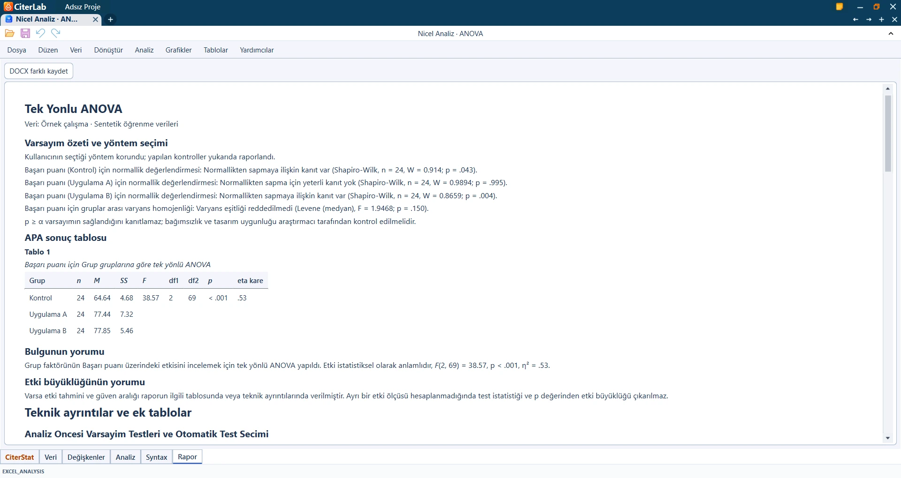</a> <a href="#module-excel_analiz"><strong>Nicel Analiz</strong></a></td>
<td><a href="#module-bib">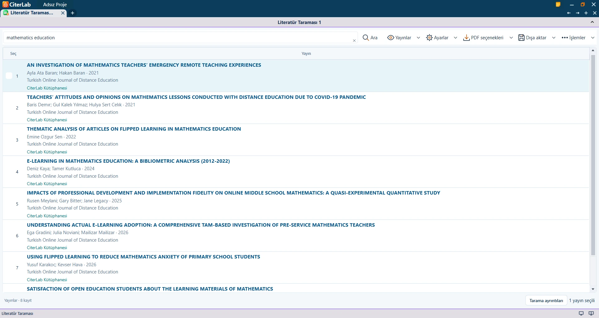</a> <a href="#module-bib"><strong>Literatür Taraması</strong></a></td>
</tr>
<tr>
<td><a href="#module-bibliometric">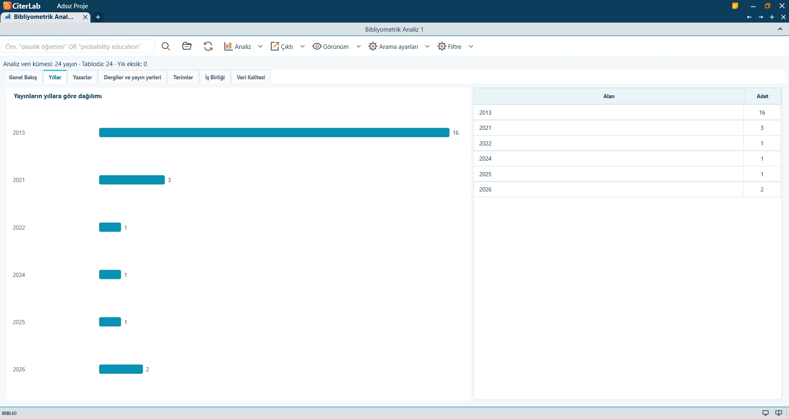</a> <a href="#module-bibliometric"><strong>Bibliyometrik Analiz</strong></a></td>
<td><a href="#module-calc">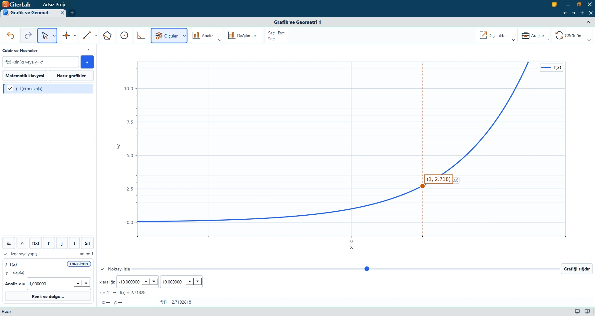</a> <a href="#module-calc"><strong>Grafik ve Geometri</strong></a></td>
</tr>
</table>

## Tüm araçlar bir bakışta

| Simge | Araç | Öne çıkan özellikler |
| --- | --- | --- |
| 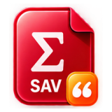 | [Nicel Analiz](#module-excel_analiz) | ANOVA ile grupları karşılaştırın Değişken rollerini açıkça belirleyin Bulguları rapora taşıyın |
|  | [Nitel Analiz](#module-qda) | Pasajları doğrudan kodlayın Kaynak ve kodları birlikte görün Temaları matrislerle inceleyin |
|  | [Literatür Taraması](#module-bib) | Yayınları tek listede inceleyin Kaynak özetlerine geçin Arama sonuçlarını dışa aktarın |
|  | [Bibliyometrik Analiz](#module-bibliometric) | Yıllara göre dağılımı görün Yazar ve kaynakları karşılaştırın Veri kalitesini inceleyin |
| 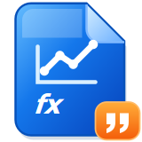 | [Grafik ve Geometri](#module-calc) | eˣ eğrisini görün Türev ve integrali inceleyin Geometri nesneleri oluşturun |
| 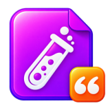 | [Araştırma Tasarımı](#module-desing) | Desenleri açıklamalarıyla inceleyin Değişken rollerini planlayın Analiz seçeneklerini değerlendirin |
|  | [Kavram Kütüphanesi](#module-concept_library) | Tanımı kaynağıyla okuyun İlişkili kavramlara geçin Metninize kaynaklı içerik ekleyin |
|  | [Veri Bankası](#module-databank) | Veri kaynaklarını keşfedin Yerel dosyanızı içe aktarın Tabloyu süzün ve inceleyin |
|  | [Başvuru Rehberleri](#module-cheatsheets) | Konular arasında hızla gezinin Formül ve örnekleri birlikte görün Rehberleri PDF veya DOCX alın |
|  | [Kaynak Arşivi](#module-library) | Arşivde arama yapın Kaynak bilgilerini inceleyin Kayıtlı belgelere geri dönün |
|  | [Kaynakça Denetimi](#module-bibliography_check) | Atıf ve kaynakçayı karşılaştırın Eşleşmeleri birlikte inceleyin Denetim raporuna geçin |
|  | [DOCX](#module-lo_docx) | Metninizi biçimlendirin Tablo ve görseller ekleyin Belgenizi çalışma alanında düzenleyin |
| 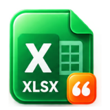 | [XLSX](#module-lo_xlsx) | Hücreleri doğrudan düzenleyin Formüllerle hesaplayın Çalışma kitabınızı kaydedin |
| 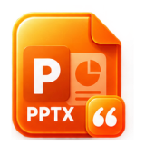 | [SUNUM](#module-lo_pptx) | Slaytları düzenleyin Metin ve görselleri birleştirin Sunumunuzu kaydedin |
|  | [GÖRSEL](#module-lo_draw) | Şekillerle anlatın Metin ve görselleri yerleştirin Çizim belgenizi kaydedin |
|  | [FORMÜL](#module-lo_math) | Formülleri ayrı sekmede çalışın Matematiksel gösterimi düzenleyin Formül belgenizi kaydedin |
|  | [VERİTABANI](#module-lo_base) | Veritabanı belgesini açın Ayrı sekmede çalışın Belgenizi kaydedin |
|  | [TXT Editör](#module-text) | Not almaya başlayın Düz metni doğrudan düzenleyin Metninizi dosyaya kaydedin |
|  | [TeX Studio](#module-tex) | LaTeX kaynağını düzenleyin Derleme çıktısını inceleyin Belge önizlemesiyle ilerleyin |
|  | [PDF Editör](#module-pdf) | Sayfalar arasında gezinin Belgede metin arayın Okuma görünümünü ayarlayın |
|  | [Karalama Defteri](#module-paint) | Serbestçe çizim yapın Renk ve kalem seçin Görsel taslaklar hazırlayın |
|  | [EPUB Okuyucu](#module-epub) | İçindekilerden bölüme geçin Kitap içinde arama yapın Yazı boyutunu ayarlayın |
|  | [Web Tarayıcısı](#module-web) | Adresi sekmede açın Sayfalar arasında gezinin Kaynakları yan yana inceleyin |
|  | [Medya Oynatıcı](#module-media) | Ses ve video açın Zaman çizelgesinde gezinin Oynatmayı kontrol edin |
|  | [Belge İşlemleri](#module-automation) | Dosyaları bir listede toplayın Belge işlemini seçin İşlem durumunu izleyin |
|  | [Hesap Makinesi](#module-mini_calc) | Temel işlemleri hesaplayın Sonucu hemen görün İşlem geçmişini izleyin |
|  | [İmza Yöneticisi](#module-signature) | İmzanızı çizerek oluşturun Görseli kırpıp düzenleyin Şeffaf önizlemeyi inceleyin |
|  | [Projelerim](#module-projects) | Projeleri bir listede görün Belgelere yeniden ulaşın Proje notlarını birlikte tutun |
|  | [Excel → Telefon Rehberi (VCF)](#module-contacts_vcf) | Kişi tablonuzu seçin Alanları açıkça eşleyin VCF çıktısı hazırlayın |

## Araçları yakından inceleyin

 <strong>Nicel Analiz</strong> · Sekme

### Veriden bulguya ilerleyin

Değişkenlerinizi seçin, uygun analizi çalıştırın ve hesaplanan sonuçları raporunuzda inceleyin.

- ANOVA ile grupları karşılaştırın
- Değişken rollerini açıkça belirleyin
- Bulguları rapora taşıyın

[Tam ekranı aç](images/gallery/excel_analiz.webp) · [Araç listesine dön](#tool-overview)

 <strong>Nitel Analiz</strong> · Sekme

### Anlamı kodlarla görünür kılın

Kaynak metinlerinizi kodlayın; seçili pasajları, notları ve temalar arasındaki ilişkileri birlikte inceleyin.

- Pasajları doğrudan kodlayın
- Kaynak ve kodları birlikte görün
- Temaları matrislerle inceleyin

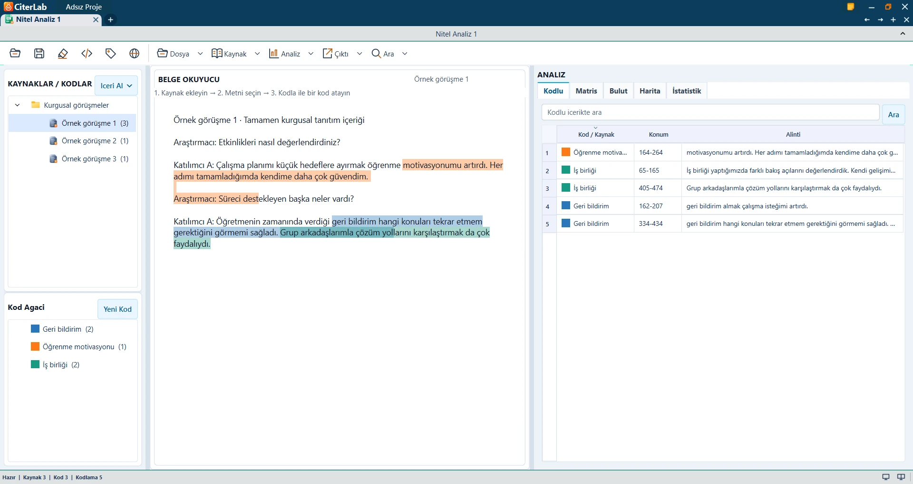

[Tam ekranı aç](images/gallery/qda.webp) · [Araç listesine dön](#tool-overview)

 <strong>Literatür Taraması</strong> · Sekme

### Araştırmanızın izini sürün

Akademik kaynaklarda arama yapın; yayınları, kaynak özetlerini ve seçili cümleleri düzenli görünümlerde inceleyin.

- Yayınları tek listede inceleyin
- Kaynak özetlerine geçin
- Arama sonuçlarını dışa aktarın

[Tam ekranı aç](images/gallery/bib.webp) · [Araç listesine dön](#tool-overview)

 <strong>Bibliyometrik Analiz</strong> · Sekme

### Literatürün örüntülerini keşfedin

Yayın verilerindeki yılları, yazarları, kaynakları ve terimleri analiz ederek araştırma alanınızı daha yakından tanıyın.

- Yıllara göre dağılımı görün
- Yazar ve kaynakları karşılaştırın
- Veri kalitesini inceleyin

[Tam ekranı aç](images/gallery/bibliometric.webp) · [Araç listesine dön](#tool-overview)

 <strong>Grafik ve Geometri</strong> · Sekme

### Matematiği çizerek keşfedin

Fonksiyonları çizin, matematik nesneleri ekleyin ve geometriyi aynı koordinat düzleminde inceleyin.

- eˣ eğrisini görün
- Türev ve integrali inceleyin
- Geometri nesneleri oluşturun

[Tam ekranı aç](images/gallery/calc.webp) · [Araç listesine dön](#tool-overview)

 <strong>Araştırma Tasarımı</strong> · Sekme

### Sorudan yöntem planına

Araştırma desenlerini inceleyin; değişkenlerinizi ve analiz seçeneklerinizi açık bir plan etrafında düzenleyin.

- Desenleri açıklamalarıyla inceleyin
- Değişken rollerini planlayın
- Analiz seçeneklerini değerlendirin

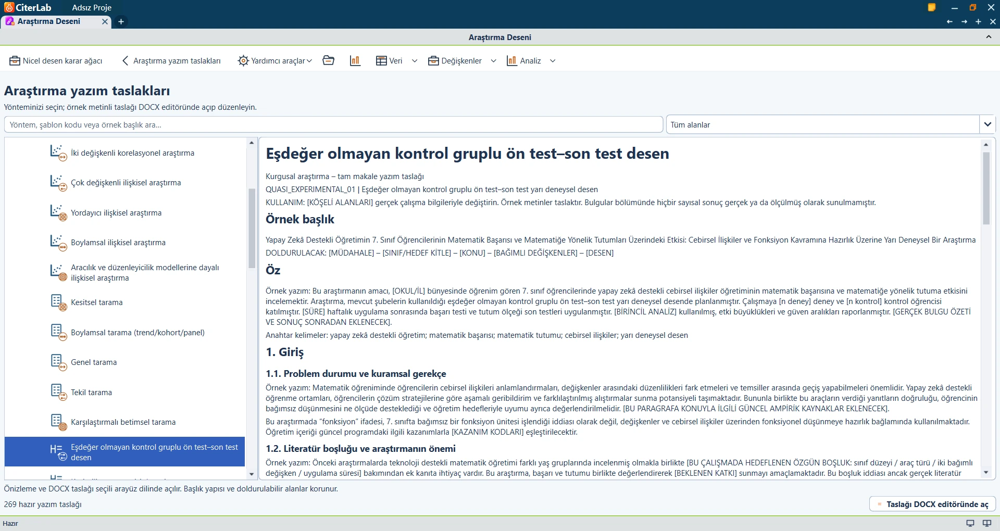

[Tam ekranı aç](images/gallery/desing.webp) · [Araç listesine dön](#tool-overview)

 <strong>Kavram Kütüphanesi</strong> · Sekme

### Kavramları bağlamıyla anlayın

Kavramları tanımları ve kaynaklarıyla keşfedin; ilişkili terimler arasında gezinin ve araştırma metninize taşıyın.

- Tanımı kaynağıyla okuyun
- İlişkili kavramlara geçin
- Metninize kaynaklı içerik ekleyin

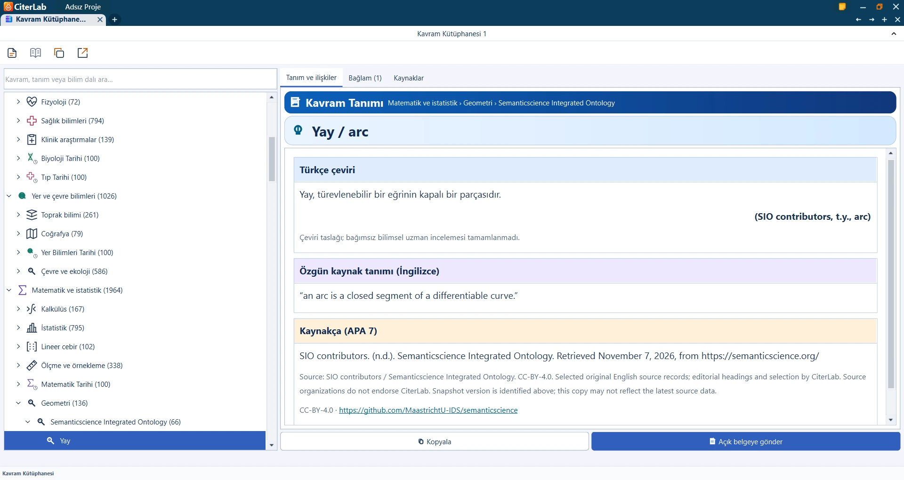

[Tam ekranı aç](images/gallery/concept_library.webp) · [Araç listesine dön](#tool-overview)

 <strong>Veri Bankası</strong> · Sekme

### Veriyi araştırmanıza bağlayın

Veri kaynaklarını keşfedin veya yerel dosyanızı açın; tabloları süzerek ihtiyaç duyduğunuz gözlemleri inceleyin.

- Veri kaynaklarını keşfedin
- Yerel dosyanızı içe aktarın
- Tabloyu süzün ve inceleyin

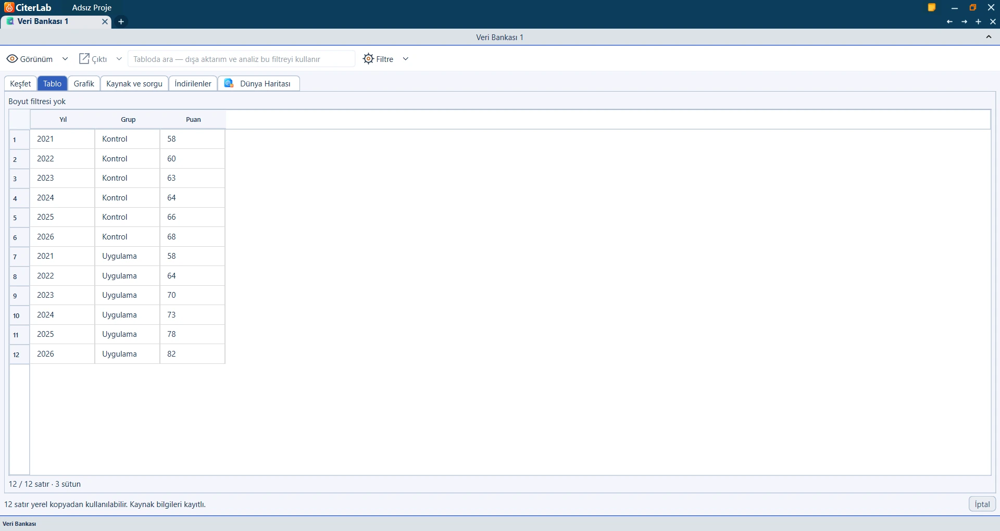

[Tam ekranı aç](images/gallery/databank.webp) · [Araç listesine dön](#tool-overview)

 <strong>Başvuru Rehberleri</strong> · Sekme

### Bilgi elinizin altında

Konu rehberlerini formülleri ve örnekleriyle okuyun; arama yapın ve seçtiğiniz rehberi dışa aktarın.

- Konular arasında hızla gezinin
- Formül ve örnekleri birlikte görün
- Rehberleri PDF veya DOCX alın

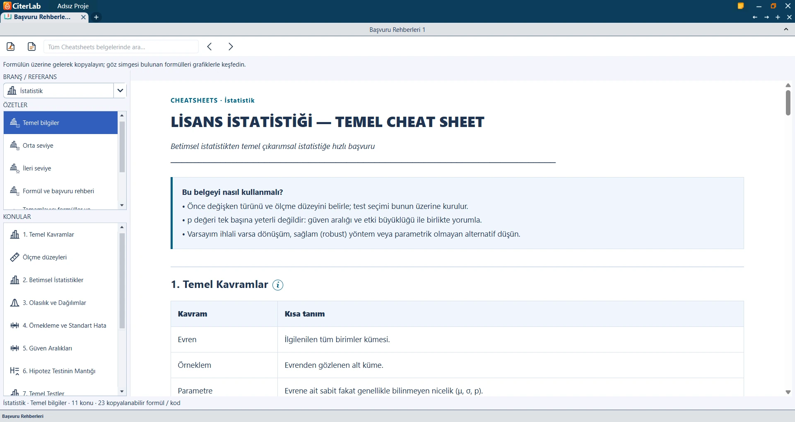

[Tam ekranı aç](images/gallery/cheatsheets.webp) · [Araç listesine dön](#tool-overview)

 <strong>Kaynak Arşivi</strong> · Sekme

### Kaynaklarınıza yeniden ulaşın

Arşivlediğiniz yayın ve belgeleri arayın; kaynak bilgilerini ve kayıtlı içeriklerini araştırmanızla birlikte inceleyin.

- Arşivde arama yapın
- Kaynak bilgilerini inceleyin
- Kayıtlı belgelere geri dönün

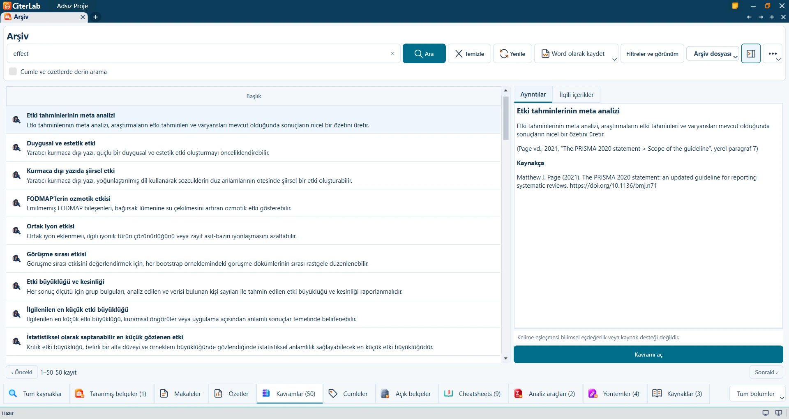

[Tam ekranı aç](images/gallery/library.webp) · [Araç listesine dön](#tool-overview)

 <strong>Kaynakça Denetimi</strong> · Sekme

### Atıfların izini kontrol edin

Belgedeki atıflarla kaynakça kayıtlarının eşleşmesini inceleyin; eşleşenleri ve gözden geçirilmesi gerekenleri raporda görün.

- Atıf ve kaynakçayı karşılaştırın
- Eşleşmeleri birlikte inceleyin
- Denetim raporuna geçin

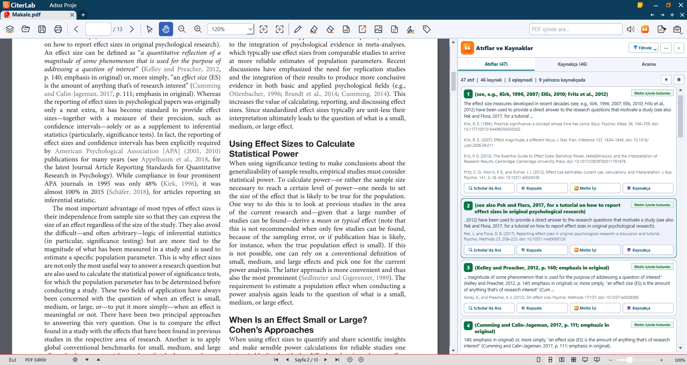

[Tam ekranı aç](images/gallery/bibliography_check.webp) · [Araç listesine dön](#tool-overview)

 <strong>DOCX</strong> · Sekme

### Bulgularınızı metne dönüştürün

Araştırma belgenizi çalışma alanında yazın; başlıklar, tablolar ve görsellerle düzenleyip kaydedin.

- Metninizi biçimlendirin
- Tablo ve görseller ekleyin
- Belgenizi çalışma alanında düzenleyin

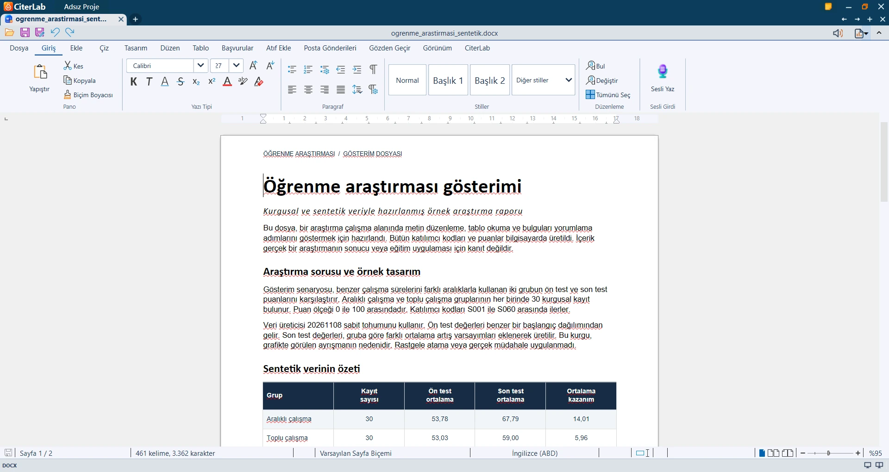

[Tam ekranı aç](images/gallery/lo_docx.webp) · [Araç listesine dön](#tool-overview)

 <strong>XLSX</strong> · Sekme

### Verilerinizi düzenli tutun

Hesap tablonuzu çalışma alanında açın; hücreleri, formülleri ve tablo düzenini belge üzerinde düzenleyin.

- Hücreleri doğrudan düzenleyin
- Formüllerle hesaplayın
- Çalışma kitabınızı kaydedin

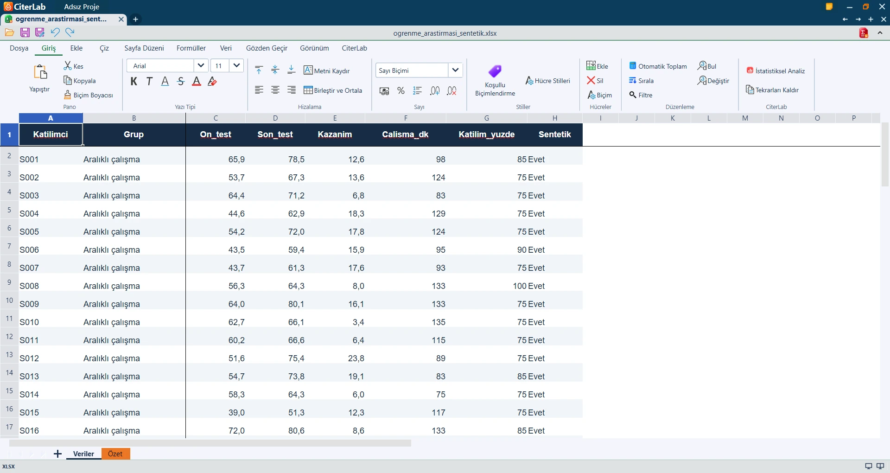

[Tam ekranı aç](images/gallery/lo_xlsx.webp) · [Araç listesine dön](#tool-overview)

 <strong>SUNUM</strong> · Sekme

### Araştırmanızı sahneye taşıyın

Sunum slaytlarınızı çalışma alanında düzenleyin; metin ve görsellerle araştırmanızın anlatısını oluşturun.

- Slaytları düzenleyin
- Metin ve görselleri birleştirin
- Sunumunuzu kaydedin

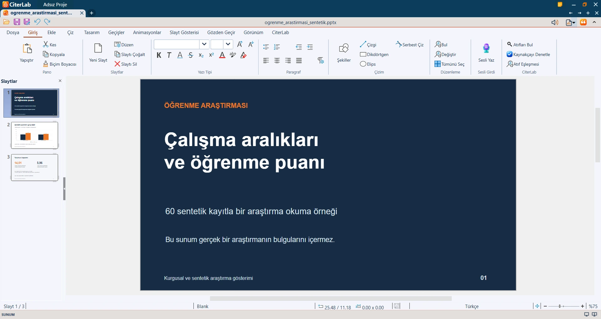

[Tam ekranı aç](images/gallery/lo_pptx.webp) · [Araç listesine dön](#tool-overview)

 <strong>GÖRSEL</strong> · Sekme

### Fikirlerinize görsel düzen verin

Çizim belgesinde şekilleri, metni ve görselleri bir araya getirerek açıklayıcı sayfalar hazırlayın.

- Şekillerle anlatın
- Metin ve görselleri yerleştirin
- Çizim belgenizi kaydedin

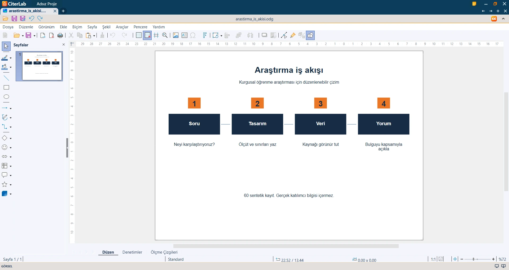

[Tam ekranı aç](images/gallery/lo_draw.webp) · [Araç listesine dön](#tool-overview)

 <strong>FORMÜL</strong> · Sekme

### Matematiksel ifadeleri düzenleyin

Formül belgenizi ayrı bir sekmede oluşturun; matematiksel gösterimi düzenleyerek çalışmanızı kaydedin.

- Formülleri ayrı sekmede çalışın
- Matematiksel gösterimi düzenleyin
- Formül belgenizi kaydedin

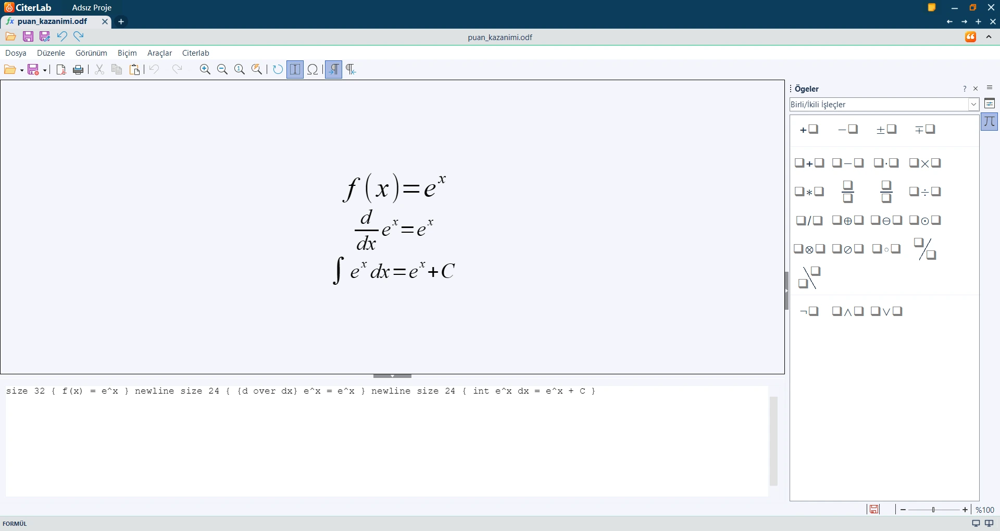

[Tam ekranı aç](images/gallery/lo_math.webp) · [Araç listesine dön](#tool-overview)

 <strong>VERİTABANI</strong> · Sekme

### Veritabanı belgenize yer açın

Veritabanı belgelerini çalışma alanındaki ayrı bir sekmede açın ve veritabanı düzenleyicisiyle çalışın.

- Veritabanı belgesini açın
- Ayrı sekmede çalışın
- Belgenizi kaydedin

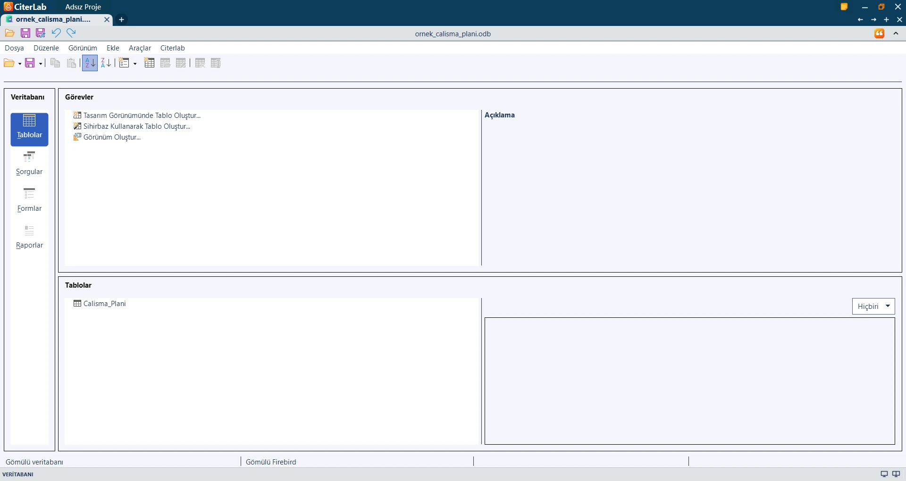

[Tam ekranı aç](images/gallery/lo_base.webp) · [Araç listesine dön](#tool-overview)

 <strong>TXT Editör</strong> · Sekme

### Düşüncenizi hemen kaydedin

Düz metin notlarınızı belge sekmesinde yazın, düzenleyin ve dosyaya kaydedin.

- Not almaya başlayın
- Düz metni doğrudan düzenleyin
- Metninizi dosyaya kaydedin

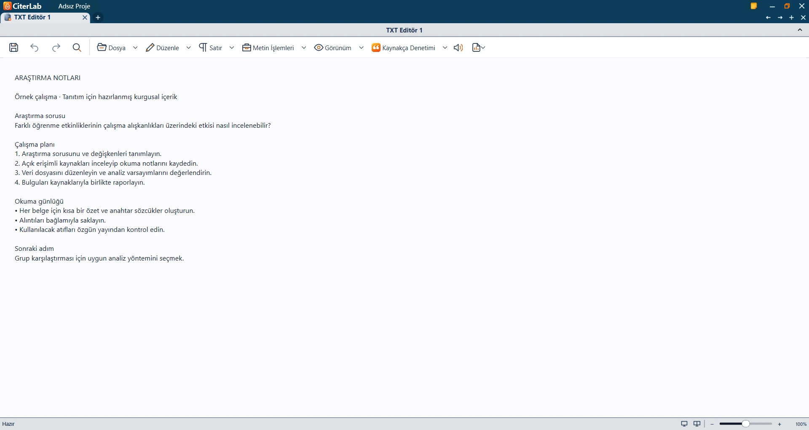

[Tam ekranı aç](images/gallery/text.webp) · [Araç listesine dön](#tool-overview)

 <strong>TeX Studio</strong> · Sekme

### Bilimsel metni özenle kurun

TeX ve LaTeX kaynağınızı düzenleyin; derleme araçlarıyla üretilen belgeyi önizleyip çalışmanızı geliştirin.

- LaTeX kaynağını düzenleyin
- Derleme çıktısını inceleyin
- Belge önizlemesiyle ilerleyin

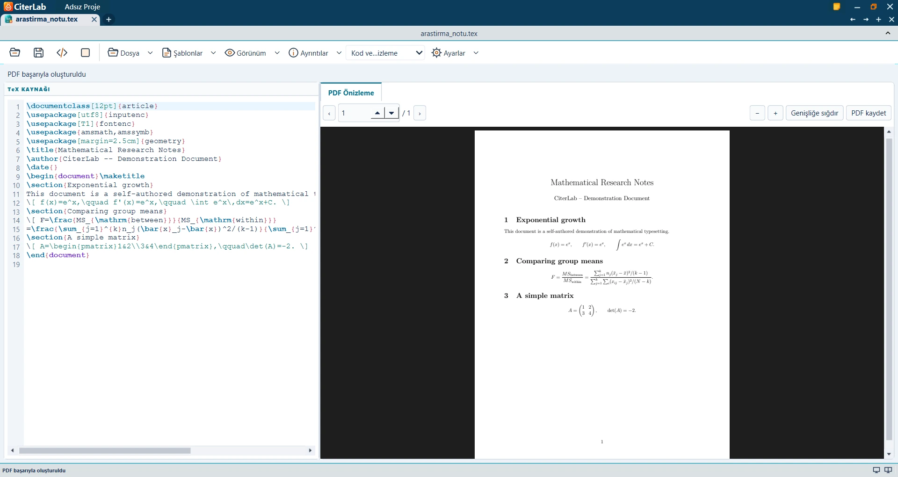

[Tam ekranı aç](images/gallery/tex.webp) · [Araç listesine dön](#tool-overview)

 <strong>PDF Editör</strong> · Sekme

### Okumayı araştırmaya bağlayın

PDF sayfalarında gezinin, metin arayın ve belgeyi araştırma araçlarınızla aynı çalışma alanında inceleyin.

- Sayfalar arasında gezinin
- Belgede metin arayın
- Okuma görünümünü ayarlayın

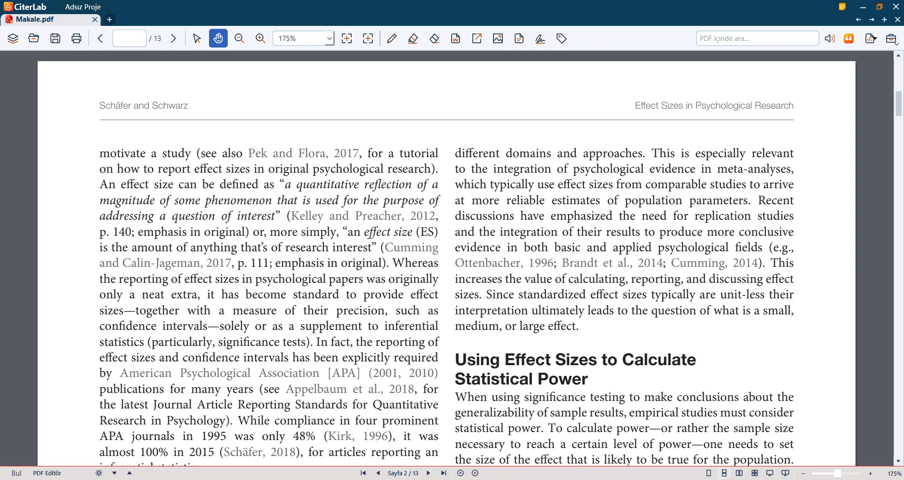

[Tam ekranı aç](images/gallery/pdf.webp) · [Araç listesine dön](#tool-overview)

 <strong>Karalama Defteri</strong> · Sekme

### Fikrin ilk çizgisini atın

Serbest çizim yapın, renklerle düşünün ve araştırma fikrinizi görsel bir taslağa dönüştürün.

- Serbestçe çizim yapın
- Renk ve kalem seçin
- Görsel taslaklar hazırlayın

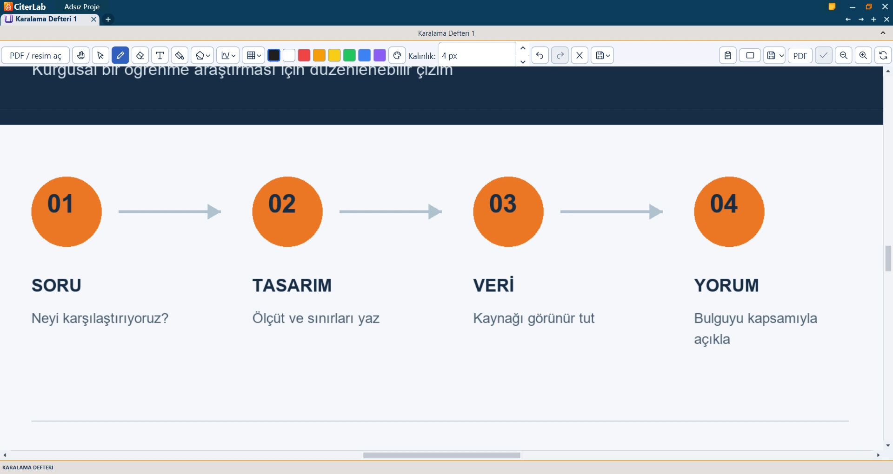

[Tam ekranı aç](images/gallery/paint.webp) · [Araç listesine dön](#tool-overview)

 <strong>EPUB Okuyucu</strong> · Sekme

### Kitap boyunca rahatça ilerleyin

EPUB kitabınızı açın; içindekiler, metin arama ve okuma ayarlarıyla ihtiyacınız olan bölüme ulaşın.

- İçindekilerden bölüme geçin
- Kitap içinde arama yapın
- Yazı boyutunu ayarlayın

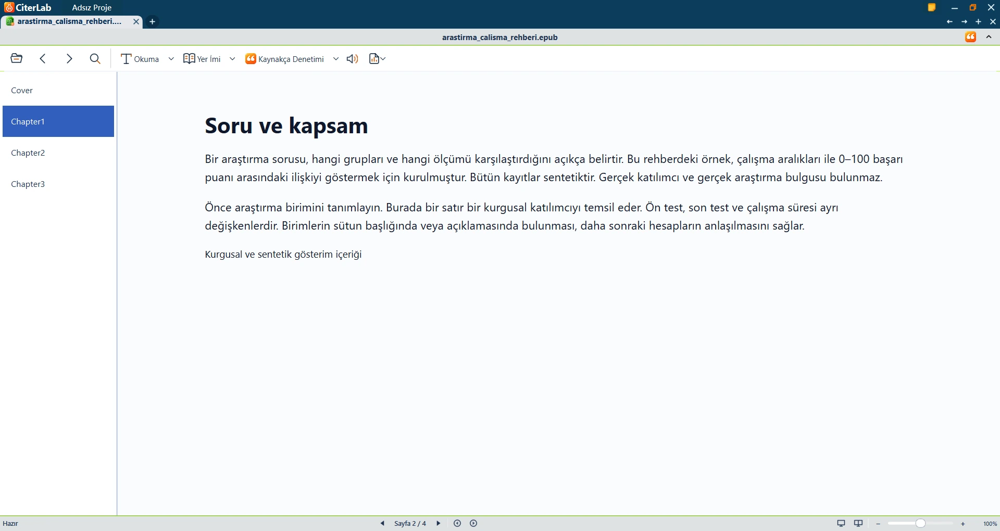

[Tam ekranı aç](images/gallery/epub.webp) · [Araç listesine dön](#tool-overview)

 <strong>Web Tarayıcısı</strong> · Sekme

### Web araştırmasını yakın tutun

Web sayfalarını çalışma alanınızdaki bir sekmede açın ve kaynakları belgelerinizle yan yana inceleyin.

- Adresi sekmede açın
- Sayfalar arasında gezinin
- Kaynakları yan yana inceleyin

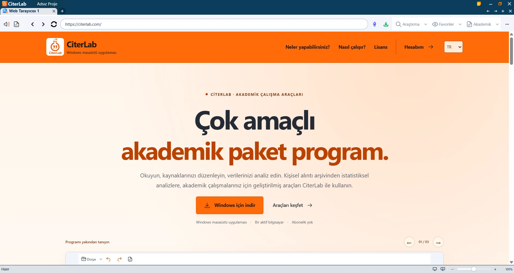

[Tam ekranı aç](images/gallery/web.webp) · [Araç listesine dön](#tool-overview)

 <strong>Medya Oynatıcı</strong> · Sekme

### Ses ve görüntüyü inceleyin

Ses veya video dosyanızı çalışma alanında açın; oynatma ve zaman çizelgesiyle ilgili bölümleri inceleyin.

- Ses ve video açın
- Zaman çizelgesinde gezinin
- Oynatmayı kontrol edin

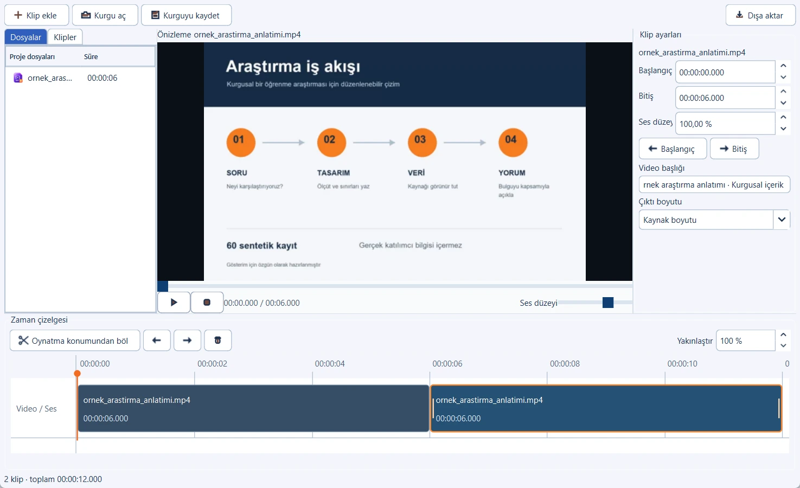

[Tam ekranı aç](images/gallery/media.webp) · [Araç listesine dön](#tool-overview)

 <strong>Belge İşlemleri</strong> · Sekme

### Belge işlerini bir araya getirin

Dosyalarınızı işlem listesine ekleyin ve dönüştürme, birleştirme ya da ayırma seçenekleriyle çalışın.

- Dosyaları bir listede toplayın
- Belge işlemini seçin
- İşlem durumunu izleyin

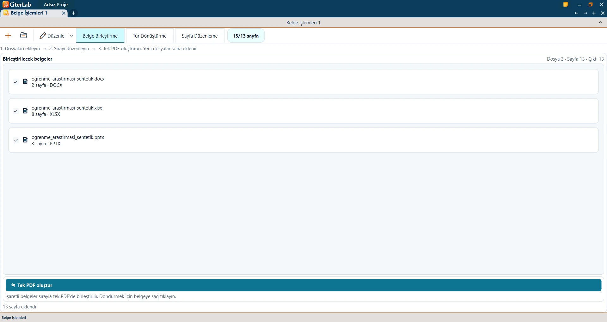

[Tam ekranı aç](images/gallery/automation.webp) · [Araç listesine dön](#tool-overview)

 <strong>Hesap Makinesi</strong> · Sekme

### Küçük hesapları hızla çözün

Günlük hesaplamalarınızı yapın ve işlem geçmişinden önceki adımları gözden geçirin.

- Temel işlemleri hesaplayın
- Sonucu hemen görün
- İşlem geçmişini izleyin

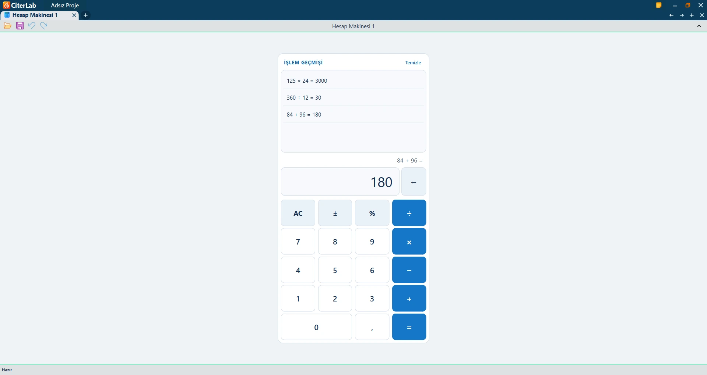

[Tam ekranı aç](images/gallery/mini_calc.webp) · [Araç listesine dön](#tool-overview)

 <strong>İmza Yöneticisi</strong> · Sekme

### Görsel imzanızı hazırlayın

İmza çiziminizi oluşturun veya bir imza görselini düzenleyin; önizleyip belgeye eklemek üzere hazırlayın.

- İmzanızı çizerek oluşturun
- Görseli kırpıp düzenleyin
- Şeffaf önizlemeyi inceleyin

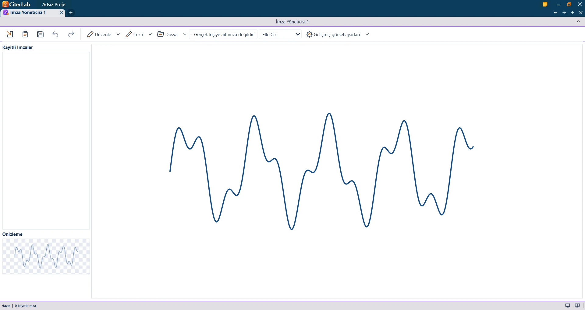

[Tam ekranı aç](images/gallery/signature.webp) · [Araç listesine dön](#tool-overview)

 <strong>Projelerim</strong> · Sekme

### Araştırmanıza kaldığınız yerden dönün

Çalışma alanlarınızı ve proje belgelerinizi birlikte görün; proje ayrıntıları ve notlarıyla çalışmanızı sürdürün.

- Projeleri bir listede görün
- Belgelere yeniden ulaşın
- Proje notlarını birlikte tutun

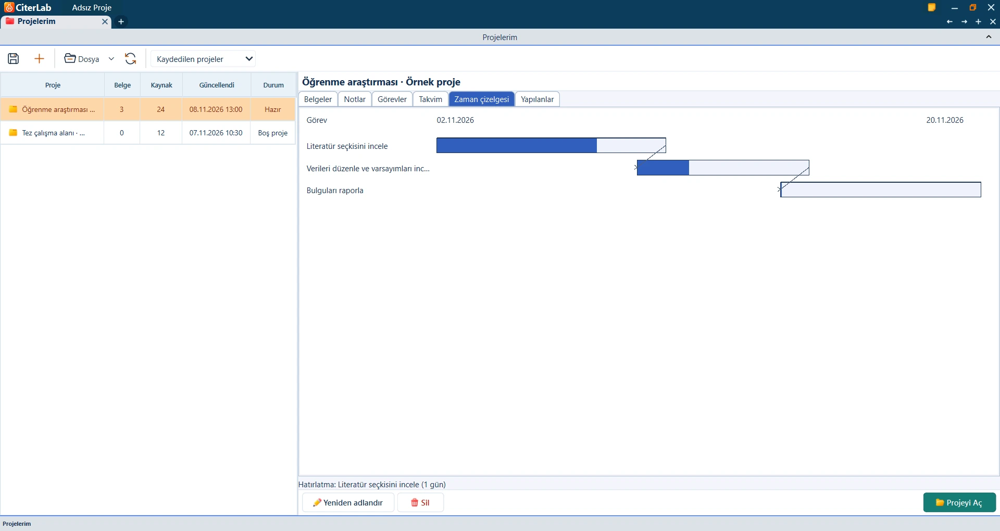

[Tam ekranı aç](images/gallery/projects.webp) · [Araç listesine dön](#tool-overview)

 <strong>Excel → Telefon Rehberi (VCF)</strong> · Diyalog

### Tablodan kişi kartlarına

Excel tablonuzdaki kişi alanlarını eşleyin ve telefon rehberine aktarılabilecek VCF dosyası hazırlayın.

- Kişi tablonuzu seçin
- Alanları açıkça eşleyin
- VCF çıktısı hazırlayın

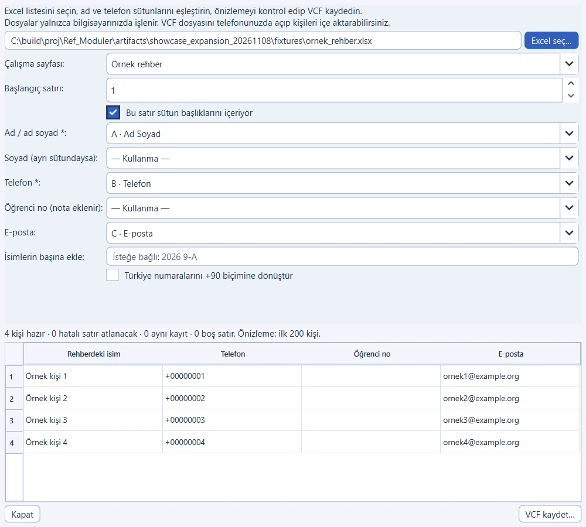

[Tam ekranı aç](images/gallery/contacts_vcf.webp) · [Araç listesine dön](#tool-overview)

## Görsel kaynakları ve bağlam

Önceki tanıtımın kaynak açıklamaları ve uyarıları aşağıda korunur. Makale lisansı ve görsel kaynakları için [ATTRIBUTIONS.txt](ATTRIBUTIONS.txt) dosyasına bakın.

- [**Grafik stüdyosu**](images/screen-charts.png) — Sentetik örnek verilerden gerçek uygulamada üretilen grafiklerdir; araştırma bulgusu değildir.
- [**Kavram Atlası**](images/screen-concepts.png) — Kaynak ve çeviri inceleme durumları uygulama ekranında korunur.
- [**Kaynakça denetimi**](images/screen-citations.png) — Gerçek açık erişimli makalenin iç sayfasıdır. Başlık sayfası gösterilmez; eşleşenler filtresi seçilidir. Sonuçlar algoritmik eşleşmedir; özgün yayınların doğrulandığı anlamına gelmez.

## Kapsam ve kullanım

Yerel araçlar ve indirilmiş kütüphane/model bileşenleri çevrimdışı kullanılabilir. İlk etkinleştirme, bileşen indirmeleri ve çevrim içi kaynak sorguları bağlantı gerektirir. Desteklenen dosya türleri ve analizlerin kapsamı işlemden işleme değişir. Eşleşmeler, analiz varsayımları ve yapay zeka çıktıları kullanıcı tarafından gözden geçirilmelidir.

## Resmî bağlantılar

- [Web sitesi](https://citerlab.com)
- Destek: [info@citerlab.com](mailto:info@citerlab.com)

## Haklar ve görsel kaynakları

CiterLab özgün içeriğine ilişkin hak bildirimi NOTICE.md içindedir. Üçüncü taraf makale ve kaynaklar kendi lisanslarını korur; ayrıntılar ATTRIBUTIONS.txt içindedir. Bu tanıtım kaydı kaynak kodunun sahipliği veya güvenilir zaman damgası belgesi değildir.

Tanıtım kaydı tarihi: 2026-11-08.
