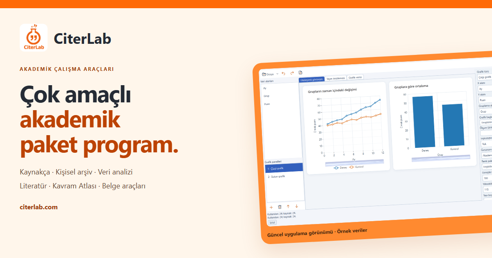
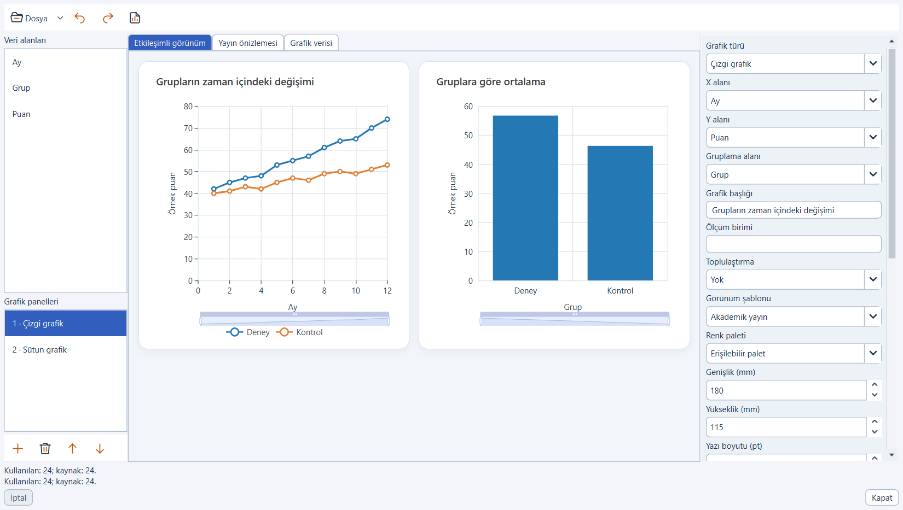
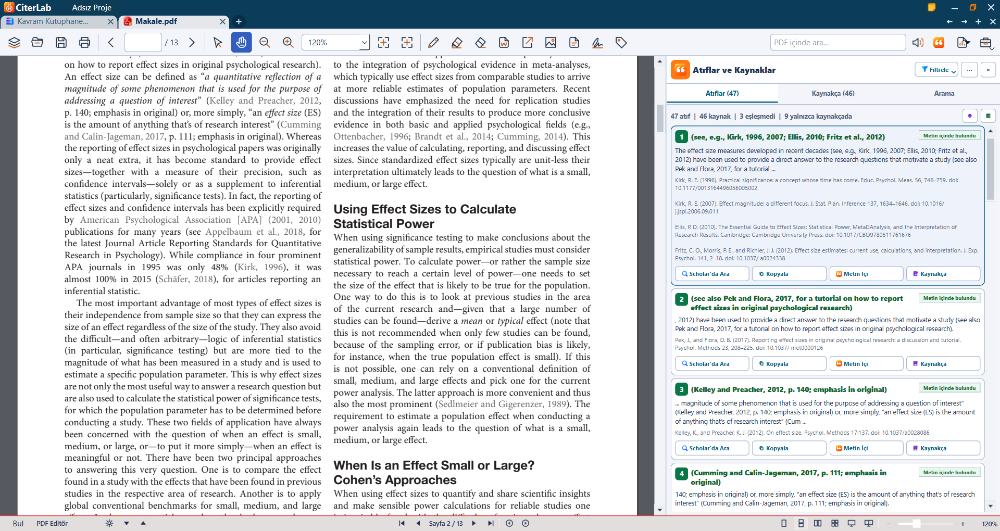

# CiterLab
[Türkçe](README.md) · [English](README.en.md) · [Deutsch](README.de.md) · [العربية](README.ar.md)

**Çok Amaçlı Akademik Paket Program**

CiterLab; kaynaklarla çalışma, kişisel alıntı arşivi, istatistiksel analiz ve belge araçlarını bir araya getiren Windows masaüstü uygulamasıdır.

Bu depo CiterLab’ın resmî ürün tanıtımıdır. Uygulamanın kaynak kodunu veya çalışan kurulum paketini içermez.

Yayın hazırlığı sürüyor. Güncel indirme ve satış durumu için resmî web sitesini kontrol edin.

## Neler yapabilirsiniz?

- **Kaynakça hatalarını daha görünür kılın** — Metin içi atıfları kaynakçayla karşılaştırın. Eksik eşleşmeleri ve olası yazım ya da biçim sorunlarını inceleyin; çevrim içi doğrulama araçlarıyla kaydın izini sürün.
- **Size ait, kaynaklarıyla yaşayan bir arşiv** — Desteklenen belgelerden seçtiğiniz alıntıları ve kaynak bilgilerini kişisel arşivinizde bir araya getirin. Yerelde arayın, kopyalayın, belgenize aktarın; arşivinizi yedekleyip başka bilgisayara taşıyın.
- **Literatürü keşfedin, erişim yolunu bilin** — İndirdiğiniz CiterLab kütüphanesinde internetsiz arayın. Bağlantınız olduğunda çevrim içi kaynaklarla araştırmanızı genişletin; uygun yayınların özetlerini arşivleyin ve erişime açık PDF'lere ulaşın.
- **Verinizi araştırma sorunuzla birlikte inceleyin** — Nicel analiz araçlarına sesle, yazarak veya doğrudan ulaşın; yöntem ve varsayımları kontrol ederek APA biçimindeki raporlardan yararlanın. Zaman serilerinde ARIMA/SARIMA; panel veride havuzlanmış OLS, sabit ve rassal etkiler ile klasik Hausman karşılaştırması kullanın.
- **Metinleri ve yayın ilişkilerini birlikte araştırın** — Nitel analiz ve bibliyometrik inceleme araçlarını aynı çalışma alanında kullanın. Bulguları inceleyin; bibliyometrik sonuçların seçilen veri kümesine, sağlayıcılara ve erişim anındaki kapsama bağlı olduğunu görün.
- **Kaynaklı bilgiye geri dönün** — Yaklaşık 10 bin kavramı, yöntem kütüphanesini ve hızlı başvuru rehberlerini keşfedin. İndirilen içeriklerde internetsiz çalışın; kaynak, dil, lisans ve çeviri inceleme durumunu birlikte değerlendirin.
- **Yapay zeka desteğini sizin tercihleriniz yönetsin** — Desteklenen metinleri özetleyin, seslendirme araçlarıyla dinleyin. Uygun donanımda indirilen yerel modelleri kullanın; isteğe bağlı bulut yapay zekasını aktarım bilgilerini inceleyip ayrıca onaylayarak açın. Özetleri her zaman kaynak metinle kontrol edin.
- **Belge işlerinizi araştırma akışında tamamlayın** — PDF'leri bölün, birleştirin ve imza araçlarını kullanın; desteklenen Office belge biçimleriyle çalışın ve uygun biçimler arasında dönüşüm yapın. İmza türünü ve son belgenin doğrulama durumunu ayrıca kontrol edin.
- **Matematiksel ilişkileri görünür hale getirin** — Grafik hesap makinesiyle fonksiyonları ve matematiksel ilişkileri dinamik olarak inceleyin. Değerleri değiştirin, grafiği gözlemleyin ve hesaplarınızı çalışma alanınızdaki diğer araçlarla birlikte sürdürün.

## Güncel uygulama ekranları

Ekranlar Türkçe arayüzden alınmıştır.

### Grafik stüdyosu

Sentetik örnek verilerden gerçek uygulamada üretilen grafiklerdir; araştırma bulgusu değildir.

### Kavram Atlası

Kaynak ve çeviri inceleme durumları uygulama ekranında korunur.

### Kaynakça denetimi

Gerçek açık erişimli makalenin iç sayfasıdır. Başlık sayfası gösterilmez; eşleşenler filtresi seçilidir. Sonuçlar algoritmik eşleşmedir; özgün yayınların doğrulandığı anlamına gelmez.

## Kapsam ve kullanım

Yerel araçlar ve indirilmiş kütüphane/model bileşenleri çevrimdışı kullanılabilir. İlk etkinleştirme, bileşen indirmeleri ve çevrim içi kaynak sorguları bağlantı gerektirir. Desteklenen dosya türleri ve analizlerin kapsamı işlemden işleme değişir. Eşleşmeler, analiz varsayımları ve yapay zeka çıktıları kullanıcı tarafından gözden geçirilmelidir.

## Resmî bağlantılar

- [Web sitesi](https://citerlab.com)
- Destek: [info@citerlab.com](mailto:info@citerlab.com)

## Haklar ve görsel kaynakları

CiterLab özgün içeriğine ilişkin hak bildirimi NOTICE.md içindedir. Üçüncü taraf makale ve kaynaklar kendi lisanslarını korur; ayrıntılar ATTRIBUTIONS.txt içindedir. Bu tanıtım kaydı kaynak kodunun sahipliği veya güvenilir zaman damgası belgesi değildir.

Tanıtım kaydı tarihi: 2026-11-08.
